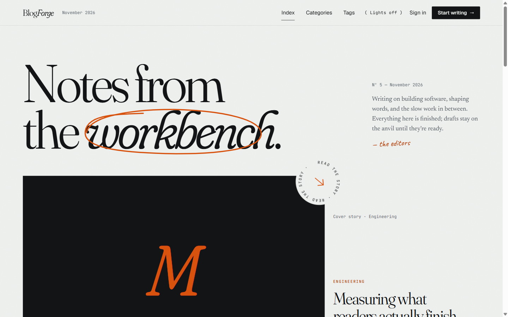
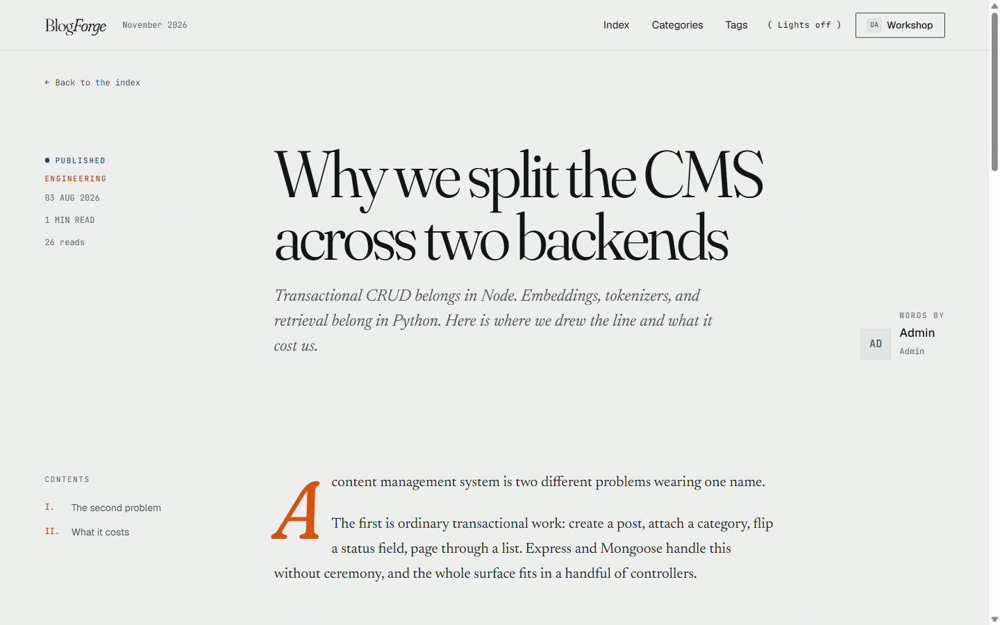
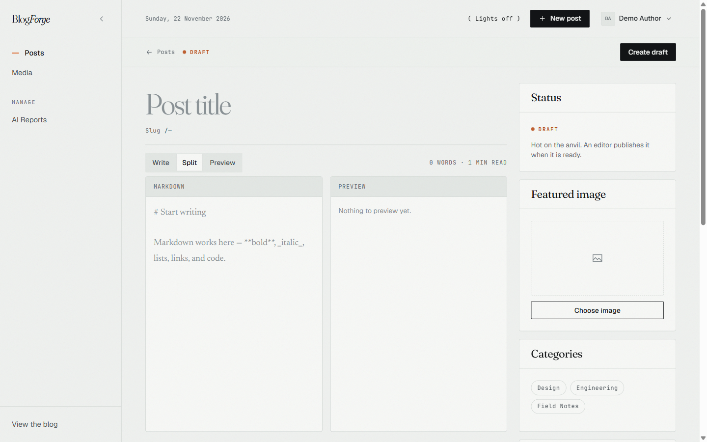
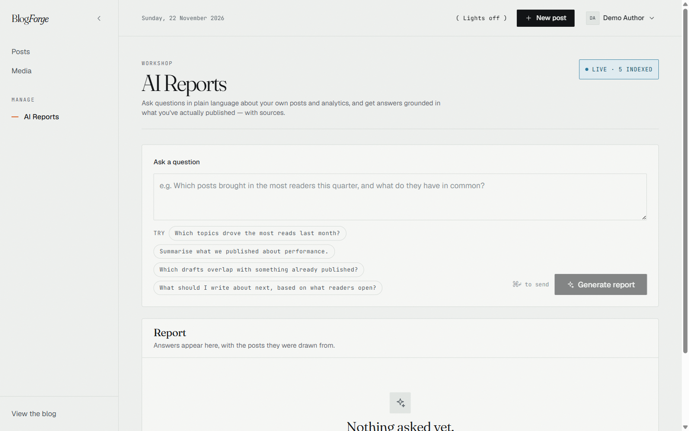

<div align="center">

# 🔨 BlogForge

### An AI-powered blogging CMS built on the MERN stack with a GenAI (RAG) layer.

**🌐 Live at [blogforge.online](https://blogforge.online)**

*Not a toy CRUD app — a system that mirrors real production patterns: API design, unified auth, role-based access, scalable aggregation, and applied Retrieval-Augmented Generation grounded in your own content.*

<br>

[](https://blogforge.online)


[](LICENSE)

[**Live demo**](https://blogforge.online) · [**Try the dashboard**](#-try-it-live) · [**Architecture**](#️-architecture) · [**Run locally**](#-getting-started) · [**Deployment**](#️-deployment)

</div>

---



## 📖 Overview

**BlogForge** is a content management system with **two faces** backed by **one core API** and a **dedicated AI microservice**:

- 🌐 **The Reader** — the public site at [blogforge.online](https://blogforge.online), where published posts are read, browsed by category / tag / author, and commented on.
- 🛠️ **The Workshop** — the authenticated dashboard at [`/workshop`](https://blogforge.online/workshop): writing, the draft → publish workflow, media, moderation, analytics, and AI Reports.

A single **JWT authentication system** (short-lived access token + revocable refresh token) secures both, with **role-based access** enforced on the server. The standout feature is **AI Reports**: a RAG pipeline that answers natural-language questions about *your own* blog — *"which topics drove the most reads last month?"* or *"what should I write about next?"* — grounded in retrieval over your published content and analytics, with source citations.

---

## 🚀 Try it live

Open **[blogforge.online](https://blogforge.online)** to read, or **[sign in](https://blogforge.online/login)** to the Workshop with a shared test account:

| Role | Email | Password | What you can do |
|---|---|---|---|
| ✍️ **Author** | `author.demo@blogforge.online` | `AuthorDemo2026` | Write drafts, upload media, view analytics for your own posts, ask AI Reports about your own posts |
| 📝 **Editor** | `editor.demo@blogforge.online` | `EditorDemo2026` | Everything an author can, plus publish / archive any post, manage categories & tags, moderate comments, see blog-wide analytics |

Or [create your own account](https://blogforge.online/register) — public sign-up always gets the **author** role.

> The **admin** role (user management, role changes, deactivation, RAG re-index) is not shared publicly, since an admin can lock other users out. It's shown in the [Workshop tour](#️-the-workshop--dashboard-tour) below.
>
> These are shared accounts: please don't change their passwords. AI Reports is rate-limited per user (30/hour, 100/day).

---

## 📸 Screenshots

| The Reader — a post | The Workshop — post editor |
|---|---|
|  |  |

| AI Reports — RAG over your own blog |
|---|
|  |

---

## 🛠️ The Workshop — dashboard tour

What each role sees after signing in at [`/workshop`](https://blogforge.online/workshop):

| Page | Author | Editor | Admin | What it does |
|---|:-:|:-:|:-:|---|
| **Posts** | own | all | all | List, search and filter posts by status; open the editor |
| **Post editor** | ✅ | ✅ | ✅ | Markdown with Write / Split / Preview, live word count & reading time, featured image, categories, tags, auto slug |
| **Publish / archive** | — | ✅ | ✅ | Move a post through draft → published → archived (publishing triggers RAG indexing) |
| **Media library** | ✅ | ✅ | ✅ | Upload to Cloudinary, browse, pick, delete |
| **AI Reports** | own posts | whole blog | whole blog | Ask questions in plain language; answers cite the posts they came from |
| **Post analytics** | own | all | all | Per-post views with daily rollups |
| **Overview / Analytics** | — | ✅ | ✅ | Blog-wide engagement trends, top posts, stat tiles, charts |
| **Comments** | — | ✅ | ✅ | Moderate threaded reader comments |
| **Categories & tags** | — | ✅ | ✅ | Manage the taxonomy |
| **Users** | — | — | ✅ | Change roles, activate / deactivate accounts (deactivation also revokes sessions) |
| **Account** | ✅ | ✅ | ✅ | Profile, bio, avatar, password change |

**The Reader** offers: a featured cover story and post index with async pagination, category / tag / author archives, a table of contents on each post, threaded comments, view tracking, SEO-friendly slugs, and a light / dark theme toggle ("Lights off").

---

## ✨ Features

### Core CMS
- 📝 **Blog post CRUD** with a markdown editor and live preview
- 🗂️ **Categories & tags** taxonomy
- 🖼️ **Media uploads** via Cloudinary
- 📋 **Draft / publish / archive** workflow with role-gated publishing
- 🔐 **Role-based access control** — `admin` / `editor` / `author`
- 💬 **Threaded comments** with moderation
- 📄 **Pagination, text search & filtering** on every list endpoint
- 📊 **Analytics** — per-post views with daily rollups and blog-wide overview
- 📦 **Standardized response envelope** + global error handler across every endpoint
- 🌓 **Editorial UI** — motion, dark mode, responsive layouts

### Authentication & security
- 🎟️ **JWT auth** — short-lived access token + revocable, rotating refresh token stored server-side
- 🛡️ **RBAC middleware** — every permission enforced on the server, never only in the UI
- 🚦 **Rate limiting** — login, sign-up (counts successes, since each account is a fresh AI budget), view tracking, and AI calls
- 🪖 **Helmet**, strict CORS allowlist, bcrypt password hashing, input validation on every write

### 🤖 AI Layer
- 🧠 **AI Reports** — natural-language insights over your blog content & analytics, with source citations
- 🔍 **RAG pipeline** — chunk → embed → store on publish; embed → retrieve top-k → generate on query
- 🧭 **Scoped by role** — an author's report only sees their own posts; editors and admins see the whole blog
- 🚧 **Guardrails before generation** — off-topic questions are refused *before* they reach the LLM (and the bill)
- ✍️ **AI assistance API** — `POST /ai/assist` for summaries, SEO recommendations, topic ideas, and improvement suggestions
- 🐍 Built with **FastAPI + LangChain** as an independently deployable, never-public microservice

---

## 🏗️ Architecture

```
                         ┌──────────────────────────────┐
     https://            │   React SPA (Vite)           │
     blogforge.online ──▶│   Reader  +  Workshop        │
                         └──────────────┬───────────────┘
                                        │  /api/v1  (same origin, via Caddy)
                         ┌──────────────▼───────────────┐
                         │   Node / Express API         │  ← the single auth boundary
                         │   JWT · RBAC · REST          │
                         └───┬──────────┬───────────┬───┘
                             │          │           │  shared service token
                    ┌────────▼───┐ ┌────▼──────┐ ┌──▼─────────────────┐
                    │  MongoDB   │ │Cloudinary │ │ FastAPI + LangChain│  ← no public port
                    │  Atlas     │ │ (media)   │ │ (AI / RAG service) │
                    └────────▲───┘ └───────────┘ └──┬─────────────────┘
                             │                      │
                             └── embeddings ◀───────┘  Atlas Vector Search
                                                       (cosine fallback)
```

**Why two backends?** The CMS is transactional CRUD — Node/Express is the right tool. The AI layer needs the Python ecosystem (LangChain, embeddings, tokenizers), so it lives in a separate FastAPI microservice that scales independently. Node always sits in front of it, so there's **one auth boundary** and the AI service is never reachable from the internet.

---

## 🧰 Tech Stack

| Layer            | Technology |
|------------------|------------|
| **Frontend**     | React 19, TypeScript, Vite, React Router 7, TanStack Query 5, react-markdown + remark-gfm, Lenis, CSS Modules |
| **Core Backend** | Node.js, Express 5, Mongoose 9, express-validator, Helmet, express-rate-limit, Multer |
| **Auth**         | JWT (access + refresh), bcrypt |
| **Database**     | MongoDB Atlas — one cluster, one DB |
| **AI Service**   | Python 3.11+, FastAPI, LangChain, OpenAI (embeddings + chat), Pydantic Settings |
| **Vector Store** | Atlas Vector Search, with in-memory cosine fallback |
| **Media**        | Cloudinary |
| **Infra**        | Docker Compose, Caddy (reverse proxy + automatic HTTPS), Oracle Cloud Ampere A1 VM |

---

## 🗄️ Data Model

One cluster, one database (`blogforge`):

| Collection        | Purpose                                  |
|-------------------|------------------------------------------|
| `users`           | Accounts + roles (RBAC)                  |
| `posts`           | Blog posts (draft / published / archived) |
| `categories`      | Category taxonomy                        |
| `tags`            | Tag taxonomy                             |
| `comments`        | Reader comments (referenced, threaded)   |
| `media`           | Cloudinary upload records                |
| `analytics`       | Per-post engagement (daily rollups)      |
| `embeddings`      | Vector chunks for RAG                    |
| `refresh_tokens`  | Revocable refresh-token store            |

> **One cluster, one DB** — a cluster is a scaling/isolation boundary, and this project has no isolation need. Comments are **referenced, not embedded** (unbounded growth + the 16 MB document limit).

---

## 🔌 API at a glance

Base URL: `https://blogforge.online/api/v1` — every response uses the same envelope: `{ success, message, data }`.

| Area | Endpoints |
|---|---|
| **Auth** | `POST /auth/register` · `POST /auth/login` · `POST /auth/refresh` · `POST /auth/logout` · `GET /auth/me` |
| **Posts** | `GET /posts` · `GET /posts/:idOrSlug` · `POST /posts` · `PATCH /posts/:id` · `DELETE /posts/:id` · `PATCH /posts/:id/publish` · `PATCH /posts/:id/archive` |
| **Comments** | `GET/POST /posts/:postId/comments` · `PATCH /comments/:id/moderate` · `DELETE /comments/:id` |
| **Taxonomy** | `GET/POST /categories` · `PATCH/DELETE /categories/:id` · `GET/POST /tags` · `PATCH/DELETE /tags/:id` |
| **Media** | `GET/POST /media` · `DELETE /media/:id` |
| **Analytics** | `POST /posts/:postId/views` · `GET /analytics/overview` · `GET /analytics/posts/:postId` |
| **Users** | `PATCH /users/me` · `PATCH /users/me/password` · `GET /users` · `PATCH /users/:id/role` · `PATCH /users/:id/status` |
| **AI** | `GET /ai/status` · `POST /ai/reports` · `POST /ai/assist` · `POST /ai/reindex` |

Health check: [`GET /health`](https://blogforge.online/health). Full detail: [`Backend/README.md`](Backend/README.md).

---

## 🔄 How the AI Reports Work (RAG)

**Ingest (on publish):** each post is split into chunks → each chunk is embedded → vectors are stored with a reference back to the source post. Ingest runs detached, so it can never block or fail a publish; editing a published post re-indexes it, and archiving or deleting drops its vectors. **Only published posts are indexed.**

**Query (on demand):**
1. The question is embedded.
2. The top-k most similar chunks are retrieved (Atlas Vector Search, or in-memory cosine if the index is missing).
3. A guardrail refuses the question if nothing relevant was retrieved *and* it uses no blog vocabulary — so off-topic prompts never reach the LLM.
4. The chunks, the question, and role-scoped analytics are assembled into a prompt.
5. The LLM answers using *only* that context, and the answer is returned with the source posts it drew from.

> **Why RAG instead of a bare LLM call?** A plain LLM knows nothing about *your* posts and will hallucinate. RAG grounds every answer in your actual content and analytics — which is the entire value of the feature.

---

## 💻 Getting Started

**Prerequisites:** Node 20+, Python 3.11+, a MongoDB Atlas cluster, a Cloudinary account, and an OpenAI API key (or any OpenAI-compatible endpoint).

```bash
git clone https://github.com/Akash9119/BlogFordge.git
cd BlogFordge

# 1. Backend — the REST API  (http://localhost:5050)
cd Backend && npm install
cp .env.example .env          # MONGODB_URI, JWT secrets, Cloudinary keys
npm run seed:admin            # creates the first admin from the ADMIN_* vars
npm run dev

# 2. AI service — the RAG microservice  (http://localhost:8010)
cd ../ai-service && python -m venv .venv && .venv/Scripts/activate   # source .venv/bin/activate on macOS/Linux
pip install -r requirements.txt
cp .env.example .env          # same MONGODB_URI, matching AI_SERVICE_TOKEN, OPENAI_API_KEY
python main.py

# 3. Frontend — the SPA  (http://localhost:5173)
cd ../Frontend && npm install && npm run dev

# Index already-published posts for RAG (once, or after connecting the AI service)
cd ../Backend && npm run ai:reindex
```

**Environment variables** — every service ships a tracked `.env.example`:

| Service | Keys |
|---|---|
| `Backend/` | `MONGODB_URI`, `JWT_SECRET`, `JWT_REFRESH_SECRET`, `CLOUDINARY_*`, `AI_SERVICE_URL`, `AI_SERVICE_TOKEN` |
| `ai-service/` | `MONGODB_URI` *(same DB)*, `AI_SERVICE_TOKEN` *(same value)*, `OPENAI_API_KEY`, `EMBEDDING_MODEL`, `CHAT_MODEL`, `VECTOR_SEARCH_MODE` |
| `Frontend/` | none required — Vite proxies `/api` to the backend in dev |

Leaving `AI_SERVICE_URL` empty disables the `/ai/*` routes; the rest of the API is unaffected. `OPENAI_API_KEY` can be swapped for `OPENAI_BASE_URL` pointed at a local OpenAI-compatible server (Ollama, LM Studio, vLLM) to run the AI layer entirely on your own machine. Full detail: [`ai-service/README.md`](ai-service/README.md).

---

## ☁️ Deployment

Production runs at **[blogforge.online](https://blogforge.online)** on a single **Oracle Cloud Always Free Ampere A1** VM:

- **Docker Compose** runs three containers: `web` (Caddy serving the built SPA), `api` (Node), and `ai` (FastAPI).
- **Caddy** is the only container with a published port — it terminates TLS with an automatically renewed **Let's Encrypt** certificate and reverse-proxies `/api/*` to Node on the same origin (no CORS preflight).
- `api` and `ai` live on a private Docker network; the AI service has **no public port at all**.
- MongoDB Atlas and Cloudinary stay managed; Atlas allowlists only the VM's reserved IP.

Updating production is `git pull && bash deploy/deploy.sh`. Step-by-step guide, operations, and troubleshooting: [`deploy/README.md`](deploy/README.md).

---

## 🛣️ Development Roadmap

Built **backend → frontend → GenAI → production**, so each layer rests on a tested foundation.

### 🟦 Phase 1 — Backend
- [x] Express server, MongoDB Atlas connection, Mongoose models
- [x] Password hashing + JWT auth (register / login / refresh / logout)
- [x] Auth + RBAC middleware, response envelope, global error handler
- [x] Posts CRUD, slugs, draft → publish workflow
- [x] Pagination, filtering, text search
- [x] Media (Cloudinary), comments, analytics endpoints

### 🟩 Phase 2 — Frontend
- [x] Workshop — auth, post editor, publish workflow, media upload
- [x] Category / tag management, comment moderation, analytics views, user management
- [x] Reader — post listing, single-post pages (SEO slugs), archives, comments
- [x] Editorial redesign with motion, dark mode, async pagination

### 🟪 Phase 3 — GenAI
- [x] FastAPI service + Node proxy routes
- [x] Ingest pipeline — chunk, embed, store vectors on publish
- [x] Retrieval + RAG end-to-end with source citations
- [x] Guardrails and per-user AI rate limits
- [x] AI Reports dashboard UI

### 🚀 Phase 4 — Production & polish
- [x] Dockerized deployment on Oracle Cloud with Caddy + automatic HTTPS
- [x] Custom domain — [blogforge.online](https://blogforge.online)
- [ ] Surface AI suggestions (summary / SEO / topics / improve) inside the post editor
- [ ] Ongoing bug fixes and edge-case validation

---

## 📁 Project Structure

```
BlogFordge/
├── Backend/            Express 5 API — routes, controllers, models, middleware, scripts
├── Frontend/           React 19 + Vite SPA — Reader and Workshop
├── ai-service/         FastAPI + LangChain RAG microservice
├── deploy/             Caddyfile, Oracle setup script, deploy script, deployment guide
├── docs/screenshots/   README images
└── docker-compose.yml  Production stack
```

---

## 👤 Author

**Akash** — [github.com/Akash9119](https://github.com/Akash9119)

Built to demonstrate full-stack range — API design, auth and RBAC, a production-quality React UI, applied GenAI, and real-world deployment — in one cohesive, live product.

## 📄 License

[MIT](LICENSE) © 2026 Akash
